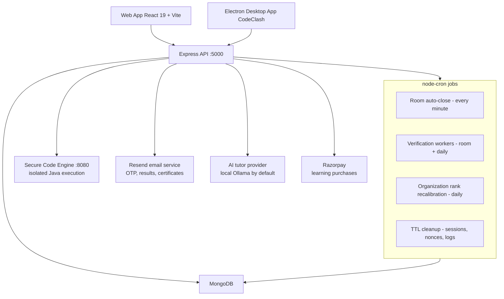

# CodeClash — Coding Challenge & Learning Platform

CodeClash (an Amux product) is a secure coding assessment and adaptive-learning platform for colleges, bootcamps, and hiring teams. It combines **Battle Rooms** (private timed contests), a **Daily Global Challenge** (server-scheduled daily contest with organization rankings), an **Adaptive Learning Center** (AI-tutored, purchase-gated courses), certificates, and an admin/creator back office — all judged server-side on an isolated Java execution engine.

---

## How the Platform Works (End-to-End Flow)

1. **Account** — a user registers with name/email/password, verifies the email with a 6-digit OTP, and then signs in with the password. Sessions use short-lived access tokens rotated by refresh tokens; sign-out revokes the session.
2. **Choose an activity** — join a Battle Room with a 6-character key, attend today's Daily Global Challenge, or open the Learning Center.
3. **Solve** — code is written in a Monaco editor (web) or the Electron desktop app, and every submission is executed and judged on the server; client-reported results are never trusted.
4. **Score & rank** — results feed per-question scores, room leaderboards, daily/organization rankings, and certificates.
5. **Deliver results** — participants see verified results, leaderboards, and downloadable PDF certificates; creators/admins get reports (PDF/Excel) and result emails.

---

## Battle Rooms (Create → Join → Battle → Results)

### Creation (Creator side)

1. A creator opens **Create Battle Room**, authors questions (title, description, difficulty, points, structured function signature, starter code, visible + hidden test cases) using the authoring wizard. Wizard helpers can auto-generate signatures, starter code, and expected outputs (reference solutions are executed server-side to compute outputs).
2. The creator configures the schedule (fixed start/end window or manual start), time limit, max participants, candidate access (`OPEN` or `ALLOWLIST` by email), moderation action (`FLAG` or `DISQUALIFY`), leaderboard visibility, and reuse permission.
3. Saving creates the room in `UPCOMING` status and generates a unique 6-character room key (e.g. `K7M2XQ`) which the creator shares with participants.
4. Rooms remain editable only while `UPCOMING` and before anyone joins. A room can also be **reused** — cloning its questions into a fresh battle instance with new scheduling.
5. If the room has no fixed schedule, the creator manually **starts** it: status flips to `ACTIVE`, the time window is computed from the time limit, and the creator is auto-joined as a participant (with their organization snapshotted).

### Joining (Participant side)

1. A verified, authenticated user enters the room key on the **Join** page.
2. The server checks: room exists and is active, the schedule window is `ACTIVE` (authoritative — the mutable status field is not trusted), the email is allowlisted when required, and the room is not full.
3. On first join, an atomic seat reservation increments the participant count (no overbooking) and creates a `BattleRoomSubmission` pre-populated with one `PENDING` result per question, snap-shotting the participant's name and organization.
4. Participants who already completed or were disqualified cannot re-enter; rejoining mid-battle resumes the existing submission.

### Battling (Solving)

1. Participants work through questions in the room's challenge view with a per-question run and a final submit.
2. **Run** executes the code against visible test cases only, creates no submission record, and is read-only.
3. **Submit** validates the request (room code, question ID, Java-only language, code ≤ 50,000 chars, replay-protecting nonce), rejects any client-supplied execution payload, records the code, and marks the question `PENDING_VERIFICATION`.
4. A background verification worker claims pending question results with a lease, executes the code on the isolated Secure Code Engine against **all** test cases (including hidden ones, which never leave the server), and stores sanitized per-test results (expected outputs and hidden cases are stripped from participant responses).
5. Integrity events (fullscreen exit, tab switch, window blur, copy/paste attempts, devtools, keyboard shortcuts) are streamed to the backend and converted into a weighted integrity risk score (LOW/MEDIUM/HIGH); depending on the room's moderation action, suspicious activity is flagged or the participant is disqualified with score zeroed.
6. **End Test** finalizes the participant's submission as `COMPLETED`.

### Results, Leaderboard & Closure

1. Room score per question = `points × passedTestCases / totalTestCases`; the submission total is the sum across questions. Ranked eligibility requires a finalized, non-disqualified submission.
2. The leaderboard ranks participants by score, then solve time, then execution efficiency. Creators additionally see emails, moderation flags, and disqualification controls; participants see only names/organizations.
3. When the window ends, a per-minute scheduler auto-closes the room (the creator can also close it early): pending submissions are finalized, certificate snapshots are refreshed, and completion/certificate emails are dispatched to participants.
4. The creator can download room reports (PDF/Excel, per-participant PDF), inspect result-delivery status, and retry failed email deliveries. Participants download their own certificates by token or from "my certificates".

---

## Daily Global Challenge (formerly Weekly Assessment route)

1. An admin authors a global challenge (question, points, test cases) and **publishes** it; a scheduler derives a 24-hour cycle per day (IST midnight-to-midnight), assigns the published question to the day, and freezes the eligible roster at cycle start.
2. A candidate opens `/weekly-assessment` (Daily Global Challenge) and sees today's assigned question and their participation state; eligibility is enforced against the frozen roster.
3. The candidate submits once per day. Submission follows the same server-authoritative path as battle rooms: desktop grant → local/remote execution → finalize, with nonce replay protection, atomic grant lifecycle (5-minute authorization, 10-minute claim lease, 24-hour recovery window), and a background verification worker (wake-up every 5 minutes). Failed or interrupted syncs can be retried within the recovery window without duplicate scoring.
4. Scoring per day: `points × passed / total` test cases. Rankings are computed per cycle:
   - **Individuals**: ordered by score, then execution time, then memory.
   - **Organizations**: mean of member scores compared against the cycle mean, ranked by final score with completion rate and tie-breakers on execution time/memory.
5. When a cycle ends, admin finalization locks rankings and persists certificates; candidates and organizations can view rankings, history, and download certificates. Admins may disqualify a candidate (with reason) before or after finalization.
6. Organization profiles are managed by admins (or self-created by organization users), and candidates can be assigned to organizations to feed organization rankings.

---

## Learning Center (Adaptive Learning)

### Student side

1. The student browses published programs, purchases a module (Razorpay order → payment verification / webhook → entitlement), and gets lifetime access to that module version.
2. The dashboard shows enrolled modules, progress, and certificates. Entering a topic starts a **server-authoritative learning session** pinned to the published content version — later edits create new immutable versions and never alter an in-progress learner's snapshot.
3. An AI tutor (local Ollama by default) teaches the current objective only, using admin-authored topic knowledge and bounded session history. Topic completion is never granted by the AI: mastery requires evidence that quotes the learner's response and cites an approved mastery criterion, validated server-side against a confidence threshold.
4. Exercises are of two kinds: **math tasks** (deterministic engine — arithmetic, percentages, ratios, roots, units, tolerances) and **Java tasks** (submitted only through the isolated secure runner; hidden test inputs/outputs never appear in student APIs). Compile errors, timeouts, malformed responses, or runner failures never grant mastery.
5. Topic completion and objective mastery are recorded in progress documents (with objective profiles and evidence history). A module is complete when all topics, the required number of exercises, and (if configured) the module assessment (70% pass) are satisfied — then a certificate is generated and emailed, and is downloadable as PDF.

### Admin (authoring) side

1. Super Admin authors programs → modules → ordered topics, each with objectives, mastery criteria, prerequisite links, misconceptions, and exercises. AI can **propose** topic drafts, but nothing reaches students until reviewed and published.
2. Publishing creates an immutable version; editing after publish creates a new version. Archival keeps existing purchases, progress, and certificates intact.
3. Admin can preview tutor responses, math tasks, and Java tasks (preview never creates learner progress, sessions, certificates, or versions), manage purchases/entitlements, and monitor AI usage (prompt/completion tokens) and completion.

---

## High-Level Design (HLD)



- **Client layer**: React SPA (web) and an Electron desktop client. Both talk to the same authenticated REST API; the desktop adds local-execution grants where the client runs code locally but only server-finalized results are trusted.
- **API layer**: Express with a middleware pipeline — request ID → logging → security (Helmet CSP/HSTS, CORS allowlist, tiered rate limiting) → body parsing (1 MB) → input sanitization → routes (JWT auth, RBAC, validation, nonce checks) → secure error handler.
- **Execution layer**: every judged submission goes through the Secure Code Engine (a separate, isolated service). The backend composes a wrapper program from the question signature, executes per test case, normalizes responses, and sanitizes everything returned to participants. Hidden test cases and expected outputs exist only server-side.
- **Data layer**: MongoDB collections for users/sessions, battle rooms + submissions, weekly cycles/rosters/submissions, challenges, organizations, learning programs/modules/versions/progress/sessions/purchases/certificates, certificates, audit logs, nonces, violations, editor analytics, and AI usage.
- **Integrity layer**: browser proctoring (fullscreen enforcement, clipboard lockdown, tab/devtools detection with auto-disqualification after 3 violations), behavioral editor analytics (aggregate metrics only, never keystrokes), server-side integrity risk scoring, and audit logging with request correlation.

---

## Low-Level Design (LLD) — Core Flows

### Submission verification (battle rooms & daily challenge)

```
Submit request (code + nonce + questionId)
│
├─ 1. Authenticate (JWT) + rate limit + validate input (regex IDs, code ≤ 50k chars)
├─ 2. Consume nonce atomically (replay protection; user + action + resource bound)
├─ 3. Reject any client-reported execution payload ("localExecution" / raw results)
├─ 4. Persist code, mark question result PENDING_VERIFICATION
├─ 5. Background worker claims result with a 10-minute lease (findOneAndUpdate guard)
├─ 6. Compose wrapper program from question signature → execute per test case
│      on the Secure Code Engine (visible + hidden cases)
├─ 7. Normalize engine response → per-test pass/fail, execution time, memory
├─ 8. Store sanitized results (hidden inputs/expected outputs never returned)
└─ 9. Score = points × passed / total; aggregate into submission totals
```

### Scoring & ranking

| Context | Rule |
|---|---|
| Battle room question | `points × passedTestCases / totalTestCases` (rounded to 2 decimals) |
| Battle room leaderboard | rank by total score → solve time → execution time → memory |
| Daily challenge question | `points × passed / total`, one attempt per day per candidate |
| Daily individual ranking | score → execution time → memory → name |
| Organization ranking | member mean vs. cycle mean, ranked by final score, then mean, then average execution time/memory; completion rate reported |
| Learning module | all topics completed + required exercises + assessment ≥ 70% (if configured) |

### Integrity & anti-cheat pipeline

1. Client `ProctorGuard` detects violations (fullscreen exit, tab switch, blur, copy/paste/cut, context menu, devtools shortcuts) and auto-disqualifies after 3 high-severity violations.
2. Events are batched and posted to `/api/assessment-integrity/events` per assessment.
3. Server computes risk: weighted events (`DEVTOOLS_OPEN` 20, `COPY/PASTE` 15, `FULLSCREEN_EXIT`/`TAB_SWITCH`/`BLUR`/`SHORTCUT` 10, +20 for sequence gaps), capped at 100 → `HIGH ≥ 60`, `MEDIUM ≥ 25`, else `LOW`.
4. Risk is surfaced on room leaderboards/reports to the creator; `DISQUALIFY` moderation zeroes the score, `FLAG` marks it for review.
5. Aggregate editor analytics (typing speed, corrections, mouse activity, paste counts) feed suspicion scoring for automation detection.

### Scheduling & lifecycle jobs

| Job | Cadence | Purpose |
|---|---|---|
| Battle room auto-close | every minute | close rooms past `endDate`, finalize submissions, refresh certificates, email results |
| Room verification worker | continuous with leases | execute & verify pending question results |
| Daily challenge verification worker | every 5 minutes | verify daily submissions within their grant lifecycle |
| Organization rank recalibration | daily midnight | re-rank organizations by Bayesian score |
| TTL cleanup | MongoDB TTL indexes | sessions, nonces (24 h), audit logs (90 days), violations/analytics (1 year) |

### Certificates & reports

- **Battle rooms**: participant certificates are generated from verified snapshots when the room closes (completion required); downloadable via token or from "my certificates"; creators get PDF/Excel room reports and per-participant PDFs.
- **Daily challenge**: certificates persisted at cycle finalization, listed and downloadable by candidates and organizations.
- **Learning**: certificate generated on verified module completion and emailed; downloadable as PDF.

### API surface (summary)

| Area | Base path | Notable operations |
|---|---|---|
| Auth | `/api/auth` | OTP registration/verification, password login, password reset, token refresh/rotation, sessions, profile |
| Creator verification | `/api/creator-verification` | email OTP to unlock creator abilities |
| Battle rooms | `/api/battle-rooms` | create/update/start/join/close/reuse/delete, authoring helpers, run/submit/end, desktop-execution grants, leaderboard (room + public), results, reports (PDF/Excel), certificates, share key |
| Daily challenge | `/api/weekly-assessments` | current cycle, submit/retry, desktop grants, rankings, history, certificates, organization profiles, admin cycles/roster/finalize/disqualification, admin global challenge publish |
| Learning | `/api/learning` | programs, purchases + Razorpay verification/webhook, sessions/tutor messages, topic completion, exercises, assessments, certificates; admin authoring (programs/modules/topics/versions/preview/purchases) |
| Execution | `/api/execute` | nonce generation, run (public cases only), submit (all cases, nonce-protected), engine health |
| Integrity | `/api/assessment-integrity` | record events, per-assessment risk reports |
| Legacy challenges | `/api/challenges` | challenge CRUD (admin) and today's challenge |
| Leaderboard | `/api/leaderboard` | global users, user rank, challenge leaderboard |
| Platform | `/api/platform` | public stats/partners, creator profile |
| System | `/api/health` | health check (200 only when MongoDB connected) |

---

## Running Locally (brief)

1. Start MongoDB and the Secure Code Engine on port `8080` (separate service in `secure-code-engine/`).
2. Configure `backend/.env` (`MONGODB_URI`, distinct JWT secrets, `SECURE_CODE_ENGINE_URL` + API key, `RESEND_API_KEY`/`EMAIL_FROM`, and AI/Razorpay settings for learning) and `frontend/.env` (`VITE_API_URL`).
3. `cd backend && npm ci && npm run dev` and `cd frontend && npm run dev`, then open `http://localhost:5173`. The Electron client lives in `desktop/`.

See `backend/README.md` for backend configuration details and `docs/learning-pilot-readiness.md` for the learning pilot checklist.

## License

MIT
